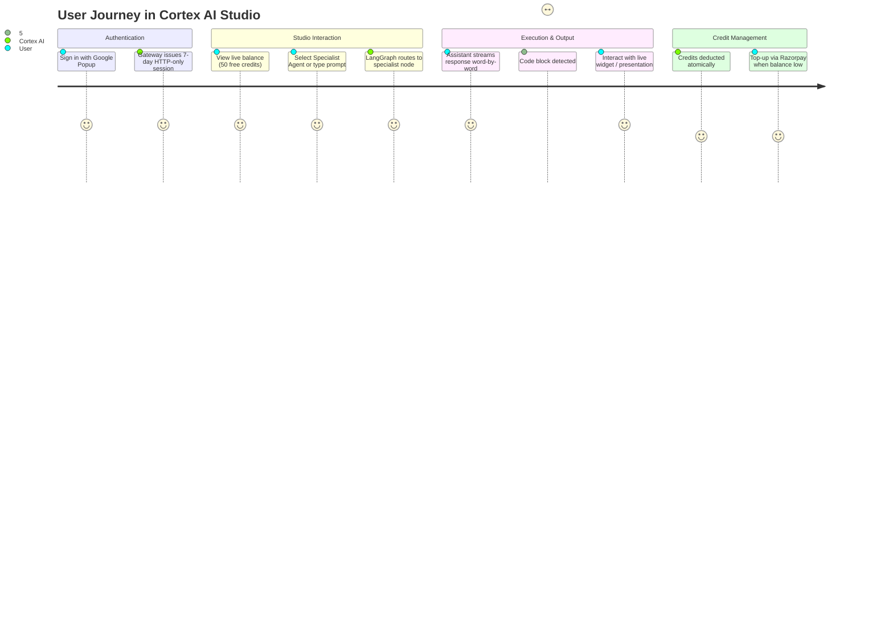

# 🌟 Product Overview — Cortex AI Studio

## 1. What is Cortex AI Studio?
**Cortex AI Studio** is an enterprise-grade, multi-agent AI platform and development workspace designed to assist software developers, architects, and knowledge workers. 

Unlike generic chatbots that rely on a single monolithic Large Language Model (LLM) to handle every task, Cortex AI implements an **Autonomous Multi-Agent Mesh powered by LangGraph**. It automatically routes user prompts to specialized AI agents fine-tuned for distinct workflows:
- **Coding & Architecture**: Software design, bug fixing, and interactive component development.
- **Interactive Presentations (PPT)**: Generating self-contained 16:9 widescreen slide decks with keyboard controls.
- **Executive PDF Documents**: Generating printable A4 corporate whitepapers and reports.
- **Real-Time Web Intelligence**: Searching the live internet with citation grounding.
- **Vision & Image Understanding**: Visual analysis and multimodal processing.
- **General Conversation**: High-speed, natural dialogue.

In addition to conversation, Cortex AI features a **Live Interactive Artifact Sandbox** (similar to Claude Artifacts), allowing users to execute and preview generated HTML, JavaScript, CSS, SVGs, and presentations live in an isolated browser iframe.

---

## 2. Why Does Cortex AI Exist? (Problem Statement)

### Problem 1: Monolithic AI Models Lack Specialization
Standard LLM chat applications use a single model configuration for everything. However, a model tuned for casual creative writing often fails at strict code generation, while a model with web search enabled may produce slow, verbose responses when a fast, simple code explanation is needed.
* **Cortex AI Solution**: Dynamically routes prompts to specialist agents powered by either **Google Gemini 2.5 Flash** (for deep reasoning, code generation, multimodal, and document layouts) or **Groq / Llama 3 120B** (for ultra-low-latency conversation and classification).

### Problem 2: Code Remains Static Text in Traditional Chats
When conventional AI tools generate HTML, CSS, or interactive UI widgets, they output raw code blocks. Users must manually copy the code, create files locally, and open them in a browser to test whether the component actually works.
* **Cortex AI Solution**: The built-in **Live Artifact Sandbox** automatically parses code blocks from streaming responses, compiles them into a live preview document, and renders interactive widgets, counter applications, presentations, and documents right beside the chat in real time.

### Problem 3: Production API Costs & Resource Abuse
Running multi-agent AI workflows consumes substantial GPU and token resources. Without strict quota controls, a few abusive users or runaway scripts can exhaust third-party API budgets within hours.
* **Cortex AI Solution**: Integrates a **Sliding-Window Redis Rate Limiter** and an **Atomic User Credit Management System** with instant **Razorpay Top-Up billing**, giving users transparent quotas with zero database contention.

---

## 3. High-Level User Journey

The diagram below illustrates how an end user interacts with Cortex AI from onboarding to live code execution:

---

## 4. Key Capabilities at a Glance

| Capability | Description | Backing Technology |
| :--- | :--- | :--- |
| **Autonomous Agent Mesh** | Multi-agent state machine that routes queries to specialized nodes. | LangGraph + LangChain |
| **Live Artifact Sandbox** | Real-time code execution environment with isolated iframe preview. | React 19 + Iframe `srcDoc` + Regex Parser |
| **Dual-Provider LLMs** | Balances ultra-fast token streaming with high-reasoning coding abilities. | Google Gemini 2.5 Flash & Groq |
| **Word-by-Word Streaming** | Conversational typewriter engine with natural reading pacing. | Custom React streaming tokenizer |
| **In-Memory Quota Guard** | High-performance sliding-window rate limiting per agent tier. | Redis Sorted Sets (`ZSET`) + `MULTI` |
| **Atomic Credit Wallet** | Pre-flight credit checks with automatic failure refunds. | Redis Lua Script (`DEDUCT_CREDITS_LUA`) |
| **Indian & Global Payments** | Seamless credit pack purchases via UPI, Cards, and Netbanking. | Razorpay Orders API & HMAC-SHA256 |
| **Persistent Chat History** | Thread-based conversation management with sub-millisecond cache hits. | MongoDB + Redis In-Memory Cache |

---

## 5. Target Audience

1. **Software Developers & Engineers**: Rapidly generate interactive UI widgets, debug complex algorithms, and test components in an isolated sandbox.
2. **Product Managers & Analysts**: Generate complete, interactive slide decks and executive research whitepapers ready to export as PDF.
3. **Students & Researchers**: Learn software architecture and retrieve up-to-date web intelligence with citations.
4. **Engineering Leaders & Architects**: Review reference architectures for production-grade multi-agent microservice systems.
