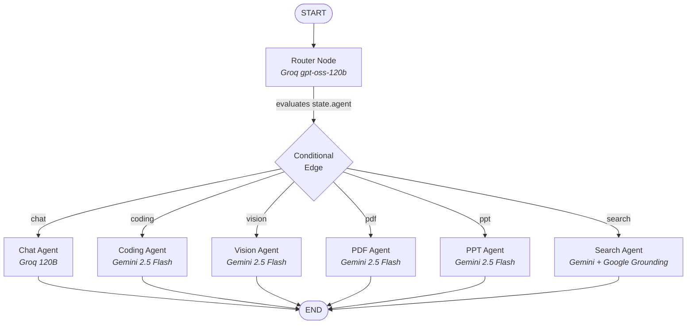

# 🤖 LangGraph Multi-Agent Mesh & Orchestration

## 1. Architectural Overview
At the core of Cortex AI is an **Autonomous Multi-Agent Mesh** orchestrated using **LangGraph** (`@langchain/langgraph`). 

Unlike simple linear prompt chains, LangGraph models agent workflows as **Stateful Cyclic Graphs (Finite State Machines)**. This allows Cortex AI to dynamically classify user intent, route execution to specialist agent nodes, maintain conversational state across turns, and support multi-step tool iterations.

---

## 2. Why LangGraph Instead of Monolithic Chains?

| Architectural Dimension | Monolithic LLM Chain | LangGraph Multi-Agent Mesh |
| :--- | :--- | :--- |
| **Model Selection** | Single model for all tasks. | Best-of-breed model per node (Gemini 2.5 Flash for coding/PPT; Groq 120B for conversational routing). |
| **Prompt Complexity** | Massive system prompts with competing instructions. | Modular, hyper-focused system prompts per agent. |
| **Extensibility** | Adding new tools risks hallucination in unrelated tasks. | New agents (e.g. Vision, PDF) are isolated nodes added to the graph topology. |
| **Error Isolation** | If a tool fails, the entire prompt fails. | Specialist nodes can execute fallbacks or transition to recovery states. |

---

## 3. Graph Topology & State Machine

The diagram below illustrates the exact execution graph defined in [`backend/services/agent/graph/graph.js`](file:///Users/anuj_gupta04/Cortex%20AI/backend/services/agent/graph/graph.js):



---

## 4. Graph State Schema (`backend/services/agent/graph/state.js`)

All nodes in the graph read from and write to a shared state notebook:

```javascript
import { Annotation } from "@langchain/langgraph";

export const agentState = Annotation.Root({
    // Full conversational history formatted for LLM context
    messages: Annotation({
        reducer: (current, next) => next ?? current ?? [],
        default: () => [],
    }),
    // The user's active prompt
    prompt: Annotation(),
    // The generated response returned by the specialist agent
    aiResponse: Annotation(),
    // The agent identifier selected by the router or requested by the user
    agent: Annotation()
});
```

---

## 5. The Router Node (`backend/services/agent/graph/router.js`)

The router acts as the intelligent traffic controller of the graph:
1. **User Overrides**: If the user explicitly selects an agent in the frontend toolbar (e.g., Presentation Agent), the router immediately honors `state.agent = "ppt"`.
2. **Intent Classification**: If no agent is specified (`auto` mode), the router analyzes the prompt using `openai/gpt-oss-120b` running on Groq with `temperature: 0` (greedy decoding for deterministic classification).
3. **Classification Taxonomy**:
   - `coding`: Code generation, debugging, refactoring, algorithms, and interactive HTML/JS widgets.
   - `ppt`: Slide decks, presentations, keynotes, and pitch decks.
   - `pdf`: Printable reports, invoices, whitepapers, and formal documents.
   - `search`: Live web search, news, current events, and documentation lookups.
   - `vision`: Image analysis, diagrams, and visual prompts.
   - `chat`: General conversation, casual dialogue, and conceptual questions.

---

## 6. Execution Lifecycle Inside Agent Controller

The request lifecycle is managed in [`backend/services/agent/controllers/agent.controller.js`](file:///Users/anuj_gupta04/Cortex%20AI/backend/services/agent/controllers/agent.controller.js):

1. **Pre-Flight Quota Reservation**: Deducts credit cost (1–5 credits) atomically in Redis before calling the graph.
2. **Conversation Context Hydration**: Retrieves previous messages from Redis cache or MongoDB (`chat-service`) and applies context window slicing (`slice(-20)`).
3. **Graph Invocation**:
   ```javascript
   const finalState = await graph.invoke(
       {
           prompt: userPrompt,
           agent: requestedAgent || undefined,
           messages: pastMessages,
       },
       { configurable: { thread_id: activeConversationId } }
   );
   ```
4. **Message Persistence**: Writes both user prompt and generated assistant response asynchronously to the Chat Service.
5. **Auto-Refund on Failure**: If the graph throws an unhandled error during execution, any deducted credits are immediately refunded to the user's Redis balance.
