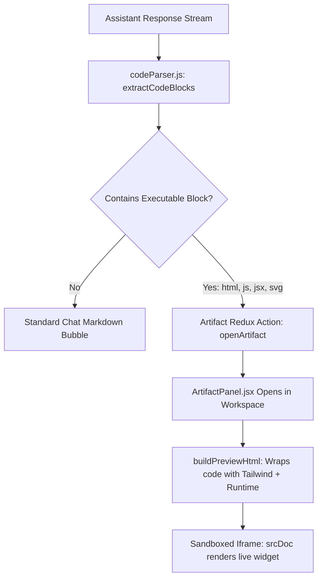

# 💻 Interactive Artifact Sandbox & Live Code Execution

## 1. Feature Overview
Cortex AI features a side-by-side **Live Interactive Artifact Sandbox** inspired by Claude Artifacts. 

When an assistant response contains runnable code (HTML, interactive JavaScript, CSS, React components, SVGs, slide decks, or printable documents), Cortex AI:
1. Automatically parses the code block from the streaming response.
2. Opens the slide-over **Artifact Panel** beside the conversation.
3. Compiles and executes the code inside a secure, sandboxed browser iframe (`srcDoc`).
4. Allows the user to toggle between **Code View** (raw syntax) and **Live Preview** (interactive app).

---

## 2. Architecture & Code Parsing Pipeline



---

## 3. Code Parsing Engine (`frontend/src/utils/codeParser.js`)

The parser inspects raw markdown text using regular expressions to extract code snippets and identify their preview capabilities:

### A. Regex Block Extractor
```javascript
export function extractCodeBlocks(markdownText) {
  const codeBlockRegex = /```([a-zA-Z0-9_-]*)\n([\s\S]*?)```/g;
  const blocks = [];
  let match;

  while ((match = codeBlockRegex.exec(markdownText)) !== null) {
    const language = (match[1] || 'plaintext').toLowerCase().trim();
    const code = match[2];
    const isPreviewable = ['html', 'jsx', 'javascript', 'js', 'svg'].includes(language);

    blocks.push({
      language,
      code,
      isPreviewable,
      title: deriveTitle(code, language),
    });
  }
  return blocks;
}
```

### B. Dynamic Virtual Document Generator (`buildPreviewHtml`)
To ensure widgets look modern and render without external build tools, `buildPreviewHtml` wraps raw code in a complete HTML document that:
- Injects **Tailwind CSS CDN** (`https://cdn.tailwindcss.com`) so generated Tailwind classes render properly.
- Injects **FontAwesome** and Google Fonts for typography.
- For React/JSX code, injects **React 18**, **ReactDOM**, and **Babel Standalone** to transpile JSX on the fly directly inside the iframe.
- Traps unhandled script errors and displays a user-friendly error overlay inside the iframe rather than crashing the parent application.

---

## 4. Security Sandbox (`iframe srcDoc`)

Untrusted AI-generated JavaScript must never execute in the top-level window context where it could access authentication cookies or localStorage tokens.

The Artifact Panel executes code inside an iframe with strict sandbox constraints:
```jsx
<iframe
  title={artifact.title}
  srcDoc={previewHtml}
  sandbox="allow-scripts allow-modals allow-forms"
  className="w-full h-full border-0 bg-[#07090e]"
/>
```

* **`allow-scripts`**: Permits execution of the widget's internal JavaScript (e.g. counters, slide transition functions).
* **`allow-modals`**: Permits standard browser dialogs (e.g. `alert()`, `confirm()`, or `window.print()`).
* **`allow-same-origin` OMITTED**: Crucially omitted so the iframe **cannot access parent window cookies, sessions, or Redux state**.

---

## 5. Word-by-Word AI Streaming Effect (`ChatMessage.jsx`)

To provide a smooth reading experience without abrupt UI repaints, Cortex AI features a client-side typewriter streaming engine:

1. **Token Splitting**: Divides the assistant text into word and whitespace chunks:
   ```javascript
   const tokens = text.match(/\S+|\s+/g) || [];
   ```
2. **Pacing Timer**: Increments visible token count on a dynamic interval:
   - Standard words: `22ms–30ms`
   - Punctuation (periods, colons, question marks): `55ms` pause to emulate natural conversational pacing.
3. **Pulsing Gradient Cursor**: Renders `<StreamingCursor />` at the current active word.
4. **Auto-Scroll Synchronization (`onStreamTick`)**: Fires a callback on each tick that gently scrolls the message viewport to keep the latest word visible without displacing outer window layouts.
5. **Instant Skip Button**: Users can click "Skip ⏭" to reveal the full response immediately.
