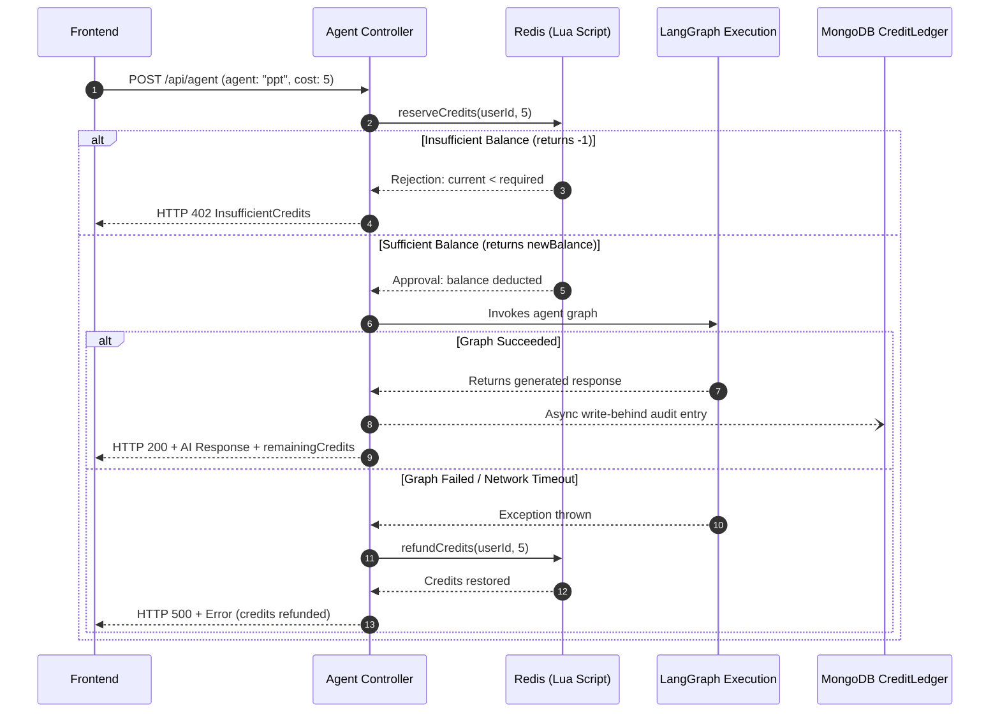

# 🛡️ Rate Limiting & User Credit Management

## 1. Overview
Cortex AI protects its backend microservices and third-party LLM billing using two distinct, complementary defense layers:

1. **Sliding-Window Rate Limiter (Edge Defense)**: Executed in the API Gateway middleware (`:8000`) to block rapid-fire volumetric spam and denial-of-service attempts (HTTP 429).
2. **Atomic User Credit Management (Resource Monetization)**: Executed in the Agent Service controller (`:8003`) to meter model token usage and ensure accounts hold sufficient funds before invoking expensive AI graphs (HTTP 402).

---

## 2. Layer 1: Sliding-Window Rate Limiter (`backend/gateway/middlewares/rateLimiter.middleware.js`)

### Fixed Window vs Sliding Window
Traditional fixed-window limiters reset counters at the turn of the minute. This creates a **boundary burst vulnerability** where a user can send 15 requests at `11:59:59` and another 15 at `12:00:01` (30 requests in 2 seconds).

Cortex AI implements a **True Sliding Window** using **Redis Sorted Sets (`ZSET`)**:

```
Timeline: Rolling 60-Second Window
[=========================== 60s Window ===========================]
  Older requests (< now-60s)  |  Req 1 (t-40s)  |  Req 2 (t-10s)  |  Current Req (NOW)
  --> Evicted via ZREMRANGE   |            Current Active Count = 2 requests
```

### Redis Command Batch (`redis.multi()`)
```javascript
const multi = redis.multi();
// 1. Evict request timestamps older than (now - 60 seconds)
multi.zremrangebyscore(key, 0, now - windowMs);
// 2. Insert current timestamp with unique member identifier
multi.zadd(key, now, `${now}-${Math.random().toString(36).substring(2, 7)}`);
// 3. Count remaining entries in the rolling window
multi.zcard(key);
// 4. Set auto-expiry for garbage collection
multi.expire(key, 65);

const results = await multi.exec();
const currentCount = results?.[2]?.[1] ?? 1;
```

### Why `multi.expire(key, 65)` Uses 65 Seconds
1. **Garbage Collection**: Prevents inactive users' rate-limit keys from lingering in Redis RAM indefinitely (prevents out-of-memory memory leaks).
2. **5-Second Grace Buffer**: Setting TTL to 65s instead of exactly 60s accommodates clock drift between microservices and network latency, ensuring edge requests near the 59th second are not prematurely dropped.

### Tiered Agent Limits
| Agent Type | Max Requests Per Minute |
| :--- | :--- |
| `chat` | 25 req/min |
| `search` | 15 req/min |
| `coding` | 12 req/min |
| `vision` | 10 req/min |
| `pdf` | 6 req/min |
| `ppt` | 6 req/min |

---

## 3. Layer 2: Atomic Credit Management (`backend/services/agent/utils/creditManager.js`)

### Agent Credit Cost Matrix
- **Conversational Chat**: 1 credit
- **Coding Agent**: 2 credits
- **Web Search Agent**: 2 credits
- **Vision Agent**: 3 credits
- **PDF Document Agent**: 3 credits
- **Presentation (PPT) Agent**: 5 credits

### The Double-Spending Challenge
Under high concurrency (e.g. user pressing Enter simultaneously across multiple browser tabs), standard `GET balance` followed by `SET balance - cost` introduces race conditions where a user with 5 credits can fire two 5-credit PPT requests at the same instant.

### Atomic Lua Script Solution (`DEDUCT_CREDITS_LUA`)
The entire balance verification and deduction executes atomically within Redis's single-threaded event loop:

```lua
local balance = tonumber(redis.call('get', KEYS[1]) or '-1')
local cost = tonumber(ARGV[1])

if balance == -1 then
  return -2 -- Cache miss: signal caller to hydrate from MongoDB
end

if balance >= cost then
  local new_balance = balance - cost
  redis.call('set', KEYS[1], new_balance)
  return new_balance -- Approved: returns new balance
else
  return -1 -- Rejected: Insufficient balance
end
```

---

## 4. Two-Phase Reserve & Settle Pattern



---

## 5. Frontend Paywall Experience (`ChatInput.jsx`)

When a user's balance drops below the cost of the currently selected agent:
1. **Dynamic Warning Banner**: Displays an informative paywall notification:
   > *"⚡ Presentation Agent requires 5 credits, but you only have 2. Top up or switch agent."*
2. **Input Disabled**: The textarea and send button are disabled to prevent rejected requests.
3. **Seamless Agent Switching**: The user can open the agent selector dropdown and switch to a cheaper agent (e.g. Chat = 1 cr, Coding = 2 cr). If their balance satisfies the cheaper agent, the warning banner disappears instantly, the textarea unlocks, and they can continue chatting without topping up.
4. **Explicit Top-Up Trigger**: The Razorpay top-up modal only opens when the user explicitly clicks the "Top Up Credits →" CTA or header balance badge, eliminating accidental interruptions.
