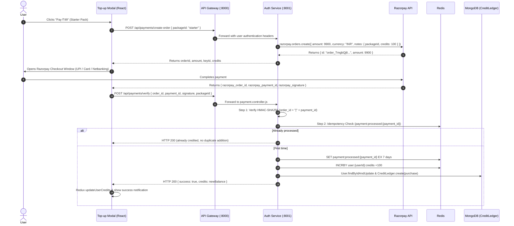

# 💳 Razorpay Payments & Credit Billing Integration

## 1. Overview
Cortex AI integrates **Razorpay** to offer seamless, secure credit pack top-ups supporting Indian and global payment methods including **UPI, Credit/Debit Cards, and Netbanking**.

All transactions are verified server-side using **HMAC-SHA256 cryptographic signatures** and guarded against replay attacks using **Redis idempotency locks**.

---

## 2. Pricing Packages

| Package Key | Package Name | Price | Credits Awarded | Cost per Credit |
| :--- | :--- | :--- | :--- | :--- |
| **`starter`** | Starter Pack | ₹99 (9,900 paise) | 100 credits | ₹0.99 |
| **`pro`** | Pro Creator *(Popular)* | ₹399 (39,900 paise) | 500 credits | ₹0.80 |
| **`creator`** | Studio Ultra | ₹999 (99,900 paise) | 1,500 credits | ₹0.66 |

Packages are centrally defined in [`backend/services/auth/controllers/payment.controller.js`](file:///Users/anuj_gupta04/Cortex%20AI/backend/services/auth/controllers/payment.controller.js) and served publicly at `/api/payments/packages`.

---

## 3. End-to-End Payment Sequence



---

## 4. Security & Anti-Fraud Protections

### A. Server-Enforced Credit Amounts (Zero Client Trust)
A common vulnerability in payment flows is trusting the client's request body (e.g. `{ credits: 100000 }`).
In Cortex AI:
* The backend completely ignores any user-supplied `credits` parameter.
* The credit amount is resolved strictly from the server-side dictionary `CREDIT_PACKAGES[packageId].credits`.

### B. Cryptographic HMAC-SHA256 Signature Verification
When a payment succeeds, Razorpay signs the concatenation of `order_id` and `payment_id` using the private `RAZORPAY_KEY_SECRET`.
The backend independently recalculates this hash:
```javascript
const body = `${razorpay_order_id}|${razorpay_payment_id}`;
const expectedSignature = crypto
  .createHmac("sha256", process.env.RAZORPAY_KEY_SECRET)
  .update(body)
  .digest("hex");

if (expectedSignature !== razorpay_signature) {
  return res.status(400).json({ success: false, message: "Invalid signature" });
}
```
If an attacker tampers with the payment ID or attempts to forge a success payload, the signatures mismatch and the request is rejected.

### C. Replay Attack & Double-Crediting Prevention (Idempotency)
If a user rapidly double-clicks the verification button, or if network retries cause the verification endpoint to be called multiple times:
```javascript
const idempotencyKey = `payment:processed:${razorpay_payment_id}`;
const alreadyProcessed = await redis.get(idempotencyKey);

if (alreadyProcessed) {
  // Gracefully return current balance without duplicate addition
  return res.status(200).json({ success: true, credits: currentBalance });
}

await redis.set(idempotencyKey, "1", "EX", 86400 * 7); // Locked for 7 days
```

---

## 5. Audit Trail (`CreditLedger` Schema)

Every balance change is permanently recorded in MongoDB for accounting and fraud audits:
* **Fields**: `userId`, `amount` (+100 for top-up, -5 for agent run), `balanceAfter`, `action` (`"purchase"`, `"agent_run"`, `"refund"`), `orderId`, and `metadata` (`paymentId`, `amountPaise`).
* Schema: [`backend/services/auth/models/creditLedger.model.js`](file:///Users/anuj_gupta04/Cortex%20AI/backend/services/auth/models/creditLedger.model.js).
