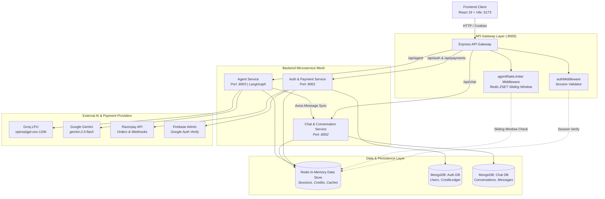

# 🏗️ System Architecture & Data Flow

## 1. Microservice Topology

Cortex AI is structured as a modular, distributed microservice architecture. Services communicate via high-speed internal HTTP and share an in-memory **Redis** cache and **MongoDB** databases.

---

## 2. Microservice Directory & Port Mapping

| Service | Port | Primary Directory | Responsibilities |
| :--- | :--- | :--- | :--- |
| **API Gateway** | `:8000` | `backend/gateway/` | Single entry point, reverse proxy routing, session validation, sliding-window rate limiting, `/api/me`. |
| **Auth Service** | `:8001` | `backend/services/auth/` | Google OAuth token verification, user profiles, Razorpay order creation and verification, credit ledger audits. |
| **Chat Service** | `:8002` | `backend/services/chat/` | Conversation management, message CRUD, cascading thread deletions, message search. |
| **Agent Service** | `:8003` | `backend/services/agent/` | LangGraph multi-agent orchestration, atomic credit reservation & refund, specialist agent prompts, LLM invocations. |
| **Frontend** | `:5173` | `frontend/` | React 19 single-page application, Redux state management, typewriter streaming, Live Artifact Sandbox. |

---

## 3. Redis In-Memory Key Architecture

Redis serves as the high-speed data backbone of Cortex AI:

| Key Pattern | Data Structure | TTL | Purpose |
| :--- | :--- | :--- | :--- |
| `session-{uuid}` | String (JSON) | 7 Days | Authenticated user session cookie mapping. |
| `ratelimit:{userId}:{agentType}` | Sorted Set (`ZSET`) | 65 Seconds | Sliding-window request timestamps for rate limiting. |
| `user:{userId}:credits` | String (Integer) | Persistent / Hydrated | Live in-memory balance for sub-millisecond atomic checks. |
| `conversation:{id}:messages` | String (JSON Array) | 24 Hours | Recent message cache for instant context hydration without Mongo disk reads. |
| `payment:processed:{paymentId}` | String (`"1"`) | 7 Days | Idempotency lock to prevent duplicate payment crediting. |

---

## 4. Reverse Proxy Stream Passthrough Pattern

### Architectural Decision: Omission of `express.json()` at Gateway
In typical Express apps, `app.use(express.json())` is mounted globally. 
However, in an API Gateway acting as a reverse proxy via `express-http-proxy`:
- Parsing the body into memory and re-serializing it back to a stream introduces significant latency and CPU overhead.
- Streaming uploads or large payloads can corrupt or crash with `Error: Can't set headers after they are sent` or `body already read`.

**Implementation**: The Cortex AI Gateway (`backend/gateway/index.js`) mounts `cookieParser()` and routes requests as **raw HTTP byte streams directly to downstream microservices**. Body parsing occurs only at the target microservice where the payload is consumed.

---

## 5. Sub-Millisecond Context Hydration (`getMessages.js`)

When an agent is invoked, the AI needs the previous conversation history. Reading 20+ messages from MongoDB on every turn creates unacceptable latency (`20ms–50ms`).

Cortex AI implements a **Write-Through / Cache-Aside Strategy**:
1. When `runAgent` starts, it checks `redis.get("conversation:<id>:messages")`.
2. **Cache Hit (`<1ms`)**: Instantly parses messages from RAM. Zero MongoDB queries.
3. **Cache Miss**: Queries Chat Service HTTP API, fetches from MongoDB, and repopulates Redis with a 24-hour TTL.
4. **Context Window Protection**: Automatically slices the latest 20 messages (`slice(-20)`) to prevent context overflow and excessive token billing.
5. **Cache Invalidation**: Any message deletion or conversation clearing immediately triggers `redis.del("conversation:<id>:messages")`.
