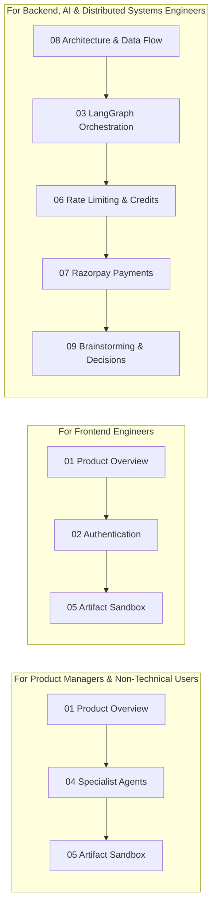

# 📚 Cortex AI Studio — Features Documentation Index

Welcome to the comprehensive feature and technical specifications library for **Cortex AI Studio**. 

This directory contains in-depth documentation covering product architecture, multi-agent workflows, code parsing sandboxes, security mechanisms, and engineering trade-offs.

---

## 🧭 Recommended Reading Path

Depending on your role and objectives, follow these curated learning paths:

---

## 📑 Feature Specifications & Architectural Guides

| File | Title | Difficulty | Target Audience | Summary |
| :--- | :--- | :--- | :--- | :--- |
| **[`01-product-overview.md`](./01-product-overview.md)** | **Product Overview** | 🟢 Beginner | All Audiences | Vision, core value proposition, problem statements, and high-level user journey. |
| **[`02-authentication-and-sessions.md`](./02-authentication-and-sessions.md)** | **Authentication & Sessions** | 🟡 Intermediate | Full-Stack / Backend | Firebase Google OAuth popup, 7-day Redis HTTP-only session cookies, and Gateway proxying. |
| **[`03-langgraph-multi-agent-orchestration.md`](./03-langgraph-multi-agent-orchestration.md)** | **LangGraph Multi-Agent Mesh** | 🔴 Advanced | AI / Backend Engineers | Stateful cyclic graph topology, finite state machines, router intent classification, and state schemas. |
| **[`04-specialist-agents.md`](./04-specialist-agents.md)** | **Specialist Agents Deep-Dive** | 🟡 Intermediate | AI / Prompt Engineers | Detailed breakdown of all 6 specialist agents: Chat, Coding, Web Search, Vision, PDF, and PPT. |
| **[`05-interactive-artifact-sandbox.md`](./05-interactive-artifact-sandbox.md)** | **Interactive Artifact Sandbox** | 🟡 Intermediate | Frontend / UI Engineers | Claude-style live code execution, regex code block extraction, sandboxed iframe, and typewriter streaming. |
| **[`06-rate-limiting-and-credit-system.md`](./06-rate-limiting-and-credit-system.md)** | **Rate Limiting & Credit System** | 🔴 Advanced | Backend / Systems Engineers | Sliding-window Redis rate limiter (`ZSET`, `MULTI`, 65s TTL) and atomic Lua credit reservation. |
| **[`07-razorpay-payments-and-billing.md`](./07-razorpay-payments-and-billing.md)** | **Razorpay Payments & Billing** | 🟡 Intermediate | Backend / FinTech | Pricing tiers, server-side HMAC-SHA256 signature verification, Redis idempotency locking, and audit ledger. |
| **[`08-system-architecture-and-data-flow.md`](./08-system-architecture-and-data-flow.md)** | **System Architecture & Data Flow** | 🔴 Advanced | System Architects | Microservice port topology, reverse proxy stream passthrough, and Redis in-memory caching architecture. |
| **[`09-brainstorming-and-design-decisions.md`](./09-brainstorming-and-design-decisions.md)** | **Brainstorming & Design Decisions** | 🟡 Intermediate | Technical Leads | Why midnight cron jobs failed, lazy credit replenishment, dual-wallet mechanics, and post-mortems. |
| **[`10-security-tradeoffs-and-roadmap.md`](./10-security-tradeoffs-and-roadmap.md)** | **Security, Trade-offs & Roadmap** | 🔴 Advanced | Security / Tech Leads | Defense-in-depth model, architectural trade-offs, and future roadmap (Vector DB / RAG, Webhooks, SSE). |

---

## 🔗 Cross-References

- **[Project Root README](../README.md)**: High-level overview, quick start, installation, and environment setup.
- **[Backend Architecture README](../backend/README.md)**: Microservices deep-dive, API endpoint index, and deployment guides.
- **[Frontend Architecture README](../frontend/README.md)**: React 19 UI component structure, state management, and styling system.
