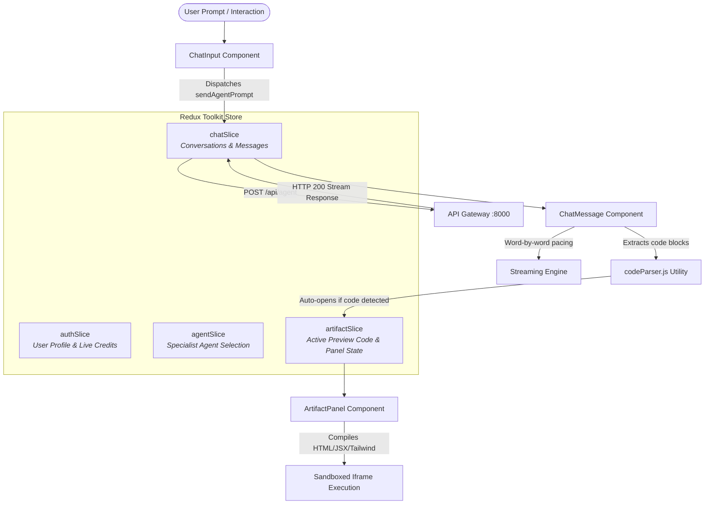

# 💻 Cortex AI — Frontend Architecture & UI Engine

Welcome to the frontend documentation for **Cortex AI Studio**. 

The frontend is a single-page application built on **React 19**, **Tailwind CSS v4**, **Redux Toolkit**, and **Vite**, featuring typewriter word-by-word streaming, regex-driven markdown parsing, a sandboxed Claude-style live Artifact execution panel, and interactive payment modals.

---

## 1. Application Architecture & Data Flow



---

## 2. Technology Stack

- **UI Library**: React 19 (`react@^19.2.x`, `react-dom@^19.2.x`).
- **Build Tool**: Vite v8 (`vite@^8.3.x`) with React Compiler support.
- **Styling**: Tailwind CSS v4 (`tailwindcss@^4.3.x`, `@tailwindcss/vite`).
- **State Management**: Redux Toolkit (`@reduxjs/toolkit@^2.13.x`, `react-redux@^9.3.x`).
- **Routing**: React Router v7 (`react-router-dom@^7.18.x`).
- **HTTP Client**: Axios (`axios@^1.20.x`) configured with `withCredentials: true`.
- **Client Authentication**: Firebase Web SDK (`firebase@^12.19.x`) for Google OAuth popups.
- **Payment SDK**: Razorpay Checkout SDK (`https://checkout.razorpay.com/v1/checkout.js`).

---

## 3. Directory Structure

```text
frontend/
├── src/
│   ├── components/
│   │   ├── ArtifactPanel.jsx        # Slide-over live code preview sandbox (iframe)
│   │   ├── ChatInput.jsx            # Dynamic prompt dock with paywall warning & agent menu
│   │   ├── ChatMessage.jsx          # Message bubble with word-by-word streaming engine
│   │   ├── CreditTopupModal.jsx     # Tiered Razorpay pricing modal (React Portal)
│   │   ├── HeroHome.jsx             # Welcome dashboard with live credits & starter cards
│   │   └── Sidebar.jsx              # Collapsible conversation history drawer & user footer
│   │
│   ├── pages/
│   │   ├── Home.jsx                 # Main workspace connecting chat, artifact, and header
│   │   ├── Login.jsx                # One-click Google sign-in landing screen
│   │   └── NotFound.jsx             # 404 error page
│   │
│   ├── redux/
│   │   ├── slices/
│   │   │   ├── agentSlice.js        # Active agent state (coding, ppt, pdf, chat, etc.)
│   │   │   ├── artifactSlice.js     # Live code, language, title, and open/close state
│   │   │   ├── authSlice.js         # Firebase auth thunks, session user, live credit balance
│   │   │   └── chatSlice.js         # Conversation CRUD, sendAgentPrompt, optimistic updates
│   │   └── store.js                 # Central Redux store configuration
│   │
│   ├── services/
│   │   └── api.js                   # Axios instance with baseUrl and cookie credentials
│   │
│   ├── utils/
│   │   ├── codeParser.js            # Regex extractor for runnable HTML/JS/CSS/SVG blocks
│   │   ├── firebase.js              # Client Firebase app initialization
│   │   └── storage.js               # LocalStorage session caching with 7-day TTL
│   │
│   ├── App.jsx                      # Route definitions and ProtectedRoute wrapper
│   ├── index.css                    # Viewport locking and dark theme variables
│   └── main.jsx                     # Application entrypoint with Redux Provider
│
├── package.json
└── vite.config.js
```

---

## 4. State Management (Redux Slices)

### A. `authSlice.js`
- **`user`**: Profile object (`_id`, `name`, `email`, `avatar`, `credits`).
- **`fetchCurrentUser`**: Asynchronously hits `/api/me` to sync user credentials and in-memory Redis credit balances.
- **`updateUserCredits`**: Instantly mutates credit balance across all components upon payment verification or agent completion.

### B. `chatSlice.js`
- **`conversations`**: List of past conversation threads displayed in the sidebar.
- **`messages`**: Active conversation messages.
- **`sendAgentPrompt`**: Dispatches prompt to `/api/agent`. Handles optimistic message append, streaming states, and traps `402 InsufficientCredits` and `429 RateLimitExceeded`.

### C. `agentSlice.js`
- **`selectedAgent`**: Active specialist agent (`"chat"`, `"coding"`, `"ppt"`, `"pdf"`, `"search"`, `"vision"`).
- **`agents`**: Registry of available agents, descriptions, models, and credit costs.

### D. `artifactSlice.js`
- **`isOpen`**: Boolean controlling slide-over visibility.
- **`code`**, **`language`**, **`title`**: Active code payload executed inside the iframe.
- **`mode`**: Toggle between `"preview"` and `"code"`.

---

## 5. UI Mechanics & Key Features

### A. Live Sandboxed Artifact Panel (`ArtifactPanel.jsx`)
- Automatically detects executable code blocks using `extractCodeBlocks` in `codeParser.js`.
- Renders code inside a secure iframe (`srcDoc`) with `sandbox="allow-scripts allow-modals allow-forms"`.
- Injects Tailwind CSS CDN and React/Babel runtimes dynamically.
- Includes a responsive viewport switch (Desktop vs Mobile simulation) and full-screen modal expansion.

### B. Word-by-Word Streaming Engine (`ChatMessage.jsx`)
- Splits assistant text into tokens (`match(/\S+|\s+/g)`).
- Renders words incrementally every 22ms–55ms with punctuation pauses.
- Fires `onStreamTick` to gently scroll the chat container without outer window jitter.
- Provides a "Skip ⏭" button for instant reveal.

### C. Interactive Paywall & Low-Credit Protection (`ChatInput.jsx`)
- If `userCredits < currentAgentCost`:
  - Disables textarea and send button.
  - Displays dynamic warning banner: *"⚡ Presentation Agent requires 5 credits, but you only have 2. Top up or switch agent."*
  - Allows user to switch to a cheaper agent (e.g. Chat = 1 cr), which immediately clears the warning and unlocks the textarea.
  - Top-up modal only opens when the user clicks the explicit "Top Up Credits →" CTA.

---

## 6. Environment Variables (`frontend/.env`)

```bash
# Gateway API base URL
VITE_API_URL=http://localhost:8000

# Firebase Client Configuration (public keys)
VITE_FIREBASE_API_KEY=AIzaSy...
VITE_FIREBASE_AUTH_DOMAIN=your-project.firebaseapp.com
VITE_FIREBASE_PROJECT_ID=your-project-id
VITE_FIREBASE_STORAGE_BUCKET=your-project.appspot.com
VITE_FIREBASE_MESSAGING_SENDER_ID=1234567890
VITE_FIREBASE_APP_ID=1:1234567890:web:...

# Razorpay Test Key ID
VITE_RAZORPAY_KEY_ID=rzp_test_YourTestKeyHere
```

---

## 7. Local Installation & Development

```bash
cd frontend

# Install dependencies
npm install

# Start Vite development server (default: http://localhost:5173)
npm run dev

# Build production bundle
npm run build

# Run linter
npm run lint
```
